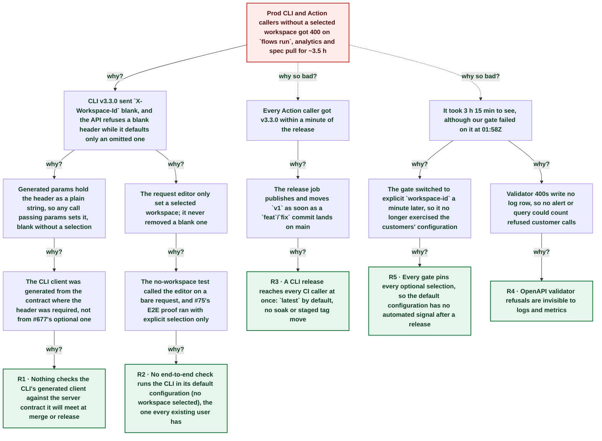

# Released CLI v3.3.0 broke `flows run` on prod for callers without a selected workspace: it sent a blank X-Workspace-Id

| | |
|---|---|
| **Date** | 2026-10-22 |
| **Severity** | SEV2 |
| **Status** | In review |
| **Service** | echopoint-cli (CLI, MCP, GitHub Action) |
| **Authors** | Nanostack routine (echopoint-investigation) |
| **Duration** | 3h 26m (trigger to resolution) |
| **Time to detect** | 3h 16m |
| **Time to mitigate** | ~3h 22m |

> Blameless: this document names systems, processes and missing guards, not people.

## Summary

CLI v3.3.0 (echopoint-cli#75) shipped at 01:57Z to let callers select a workspace. Its generated client stores `X-Workspace-Id` as a plain string, so every call built with a params struct sent the header **blank** when no workspace was selected. The API refuses a blank header with 400 and only defaults an *omitted* one to the organization's only workspace (echopoint#677, merged 27 minutes earlier). Every CLI and Action caller on `latest` without `--workspace` / `workspace-id` lost `flows run --tag`, `flows run <id>`, `analytics` and `spec pull`. Our own gate hit the same 400 at 01:58Z, but went green a minute later once it began passing the workspace explicitly, so the break looked like the known SEV2. The 05:08Z suite routine found it when a new flow failed to launch; echopoint-cli#77 drops the blank header and ships as v3.3.1.

## Impact

Customers who updated the CLI or used the GitHub Action (installs `latest` by default) without selecting a workspace got 400 `X-Workspace-Id ... minLength: got 0` on prod from 01:57Z. `flows list`, `flows get` and other commands that pass no params kept working, which hid the scope. The number of affected callers is unknown: the OpenAPI validator answers before request logging, so no log row records these 400s.

- **~3.5 h** v3.3.0 latest, broken for default config
- **6** command families refused (run --tag, run <id>, analytics x3, spec pull, folder delete)
- **0** log rows: validator 400s are not logged

## Trigger

Release of CLI v3.3.0 at 01:57:24Z (echopoint-cli#75) and the Action `v1` tag moving to it: callers without a selected workspace sent `X-Workspace-Id: ` (blank).

## Detection

The 01:58Z echopoint post-deploy gate failed on this exact 400, but ci-workflows#35 (explicit `workspace-id`) merged at 01:57:50Z and the next gate passed at 02:01Z, so the failure was read as the known SEV2 rollout. The 05:08Z routine detected it at 05:13:36Z when `echopoint: workspace default` failed at the ephemeral claim with released v3.3.0 and no workspace set, while v3.2.1 passed.

## Resolution

echopoint-cli#77 makes `WithWorkspaceHeader("")` delete the blank header generated params set, with a test on a generated request. Verified live on prod: v3.3.0 `analytics summary` and `flows run` 400, the fixed build 200. Merging `fix:` releases v3.3.1, which the Action's `latest` picks up. Workaround until then: pass `--workspace` / `ECHOPOINT_WORKSPACE_ID` / Action `workspace-id`, or pin CLI v3.2.1.

## Timeline (UTC)

| Time | | Event |
|---|---|---|
| 00:19:56 | T−1d 01h | **Required X-Workspace-Id (#667) reaches prod** Earlier SEV2: released clients get 400. ([link](https://claude.ai/artifact/KSNoucj4HagcnS4W5awiRg)) |
| 01:30:09 | T−27m 15s | **echopoint#677 merged: omitted header defaults** Header becomes `required: false`; a **blank** header stays 400. ([link](https://github.com/nanostack-dev/echopoint/pull/677)) |
| 01:56:32 | T−52s | **echopoint-cli#75 merged (client generated pre-#677)** 103 params structs keep `XWorkspaceId RequiredWorkspaceIDHeader` (plain string). ([link](https://github.com/nanostack-dev/echopoint-cli/pull/75)) |
| 01:57:24 | T+0s | **CLI v3.3.0 released; Action v1 moves to it** ([link](https://github.com/nanostack-dev/echopoint-cli/releases/tag/v3.3.0)) |
| 01:57:50 | T+26s | **ci-workflows#35: gates pass workspace-id** ([link](https://github.com/nanostack-dev/ci-workflows/pull/35)) |
| 01:58:16 | T+52s | **Gate fails on blank header; read as known SEV2** Run dispatched 01:34Z, suite job ran 01:58Z on Action v1 = v3.3.0 with the pre-#35 caller. ([link](https://github.com/nanostack-dev/infra/actions/runs/39706486360)) |
| 02:01:08 | T+3m 44s | **Next gate green with explicit workspace** ([link](https://github.com/nanostack-dev/infra/actions/runs/39708813975)) |
| 05:13:36 | T+3h 16m | **Routine: new flow fails at ephemeral claim (v3.3.0)** `claim ephemeral Job: status 400 ... minLength: got 0`; same flow green on v3.2.1. |
| ~05:19 | T+3h 22m | **echopoint-cli#77 opened, fix verified live on prod** ([link](https://github.com/nanostack-dev/echopoint-cli/pull/77)) |
| 05:23:24 | T+3h 26m | **v3.3.1 released; Action v1 moves to it** ([link](https://github.com/nanostack-dev/echopoint-cli/releases/tag/v3.3.1)) |
| ~05:40 | T+3h 42m | **Both suites green on released v3.3.1, no workspace set** |

## Root cause analysis: the five whys

Start at the impact and ask why until the answer is something the team can change. Solid edges ask why it happened; dashed edges ask why the impact was as large as it was.

- **Problem:** Prod CLI and Action callers without a selected workspace got 400 on `flows run`, analytics and spec pull for ~3.5 h
  - **Why?** CLI v3.3.0 sent `X-Workspace-Id` blank, and the API refuses a blank header while it defaults only an omitted one _Evidence: `curl -H 'X-Workspace-Id;'` → 400 `minLength: got 0`; without the header → 200 (prod, 05:20Z)_
    - **Why?** Generated params hold the header as a plain string, so any call passing params sets it, blank without a selection _Evidence: `client.gen.go`: 103 `XWorkspaceId RequiredWorkspaceIDHeader`; `NewClaimEphemeralJobRequestWithBody` always calls `req.Header.Set`_
      - **Why?** The CLI client was generated from the contract where the header was required, not from #677's optional one _Evidence: #677 merged 01:30Z with `required: false`; #75 merged 01:56Z still generated as required_
        - **Why?** Nothing checks the CLI's generated client against the server contract it will meet at merge or release → **Root cause R1** (fixed by A3)
    - **Why?** The request editor only set a selected workspace; it never removed a blank one _Evidence: `WithWorkspaceHeader`: `if workspaceID != "" { Set }`_
      - **Why?** The no-workspace test called the editor on a bare request, and #75's E2E proof ran with explicit selection only _Evidence: `TestMissingWorkspaceDoesNotInventSelection`; #35 body: suites passed 'with explicit control-plane selection'_
        - **Why?** No end-to-end check runs the CLI in its default configuration (no workspace selected), the one every existing user has → **Root cause R2** (fixed by A1, A2)
  - **Why so bad?** Every Action caller got v3.3.0 within a minute of the release _Evidence: Action `cli-version` defaults to `latest`; `v1` tag moved to 60d8b00 by the release job_
    - **Why?** The release job publishes and moves `v1` as soon as a `feat`/`fix` commit lands on main _Evidence: `docs/runbooks/deployment.md`; Release run 01:56:35-01:57:35Z for 60d8b00_
      - **Why?** A CLI release reaches every CI caller at once: `latest` by default, no soak or staged tag move → **Root cause R3** (fixed by A5)
  - **Why so bad?** It took 3 h 15 min to see, although our gate failed on it at 01:58Z _Evidence: infra run 39706486360 failed with the blank-header 400; run 39708813975 passed after ci-workflows#35_
    - **Why?** The gate switched to explicit `workspace-id` a minute later, so it no longer exercised the customers' configuration
      - **Why?** Every gate pins every optional selection, so the default configuration has no automated signal after a release → **Root cause R5** (fixed by A2, A4, A7)
    - **Why?** Validator 400s write no log row, so no alert or query could count refused customer calls _Evidence: PostHog logs `echopoint`: 0 rows matching `X-Workspace-Id` over 24 h_
      - **Why?** OpenAPI validator refusals are invisible to logs and metrics → **Root cause R4** (fixed by A6)

## Root causes

- **R1** Nothing checks the CLI's generated client against the server contract it will meet at merge or release
- **R2** No end-to-end check runs the CLI in its default configuration (no workspace selected), the one every existing user has
- **R3** A CLI release reaches every CI caller at once: `latest` by default, no soak or staged tag move
- **R5** Every gate pins every optional selection, so the default configuration has no automated signal after a release
- **R4** OpenAPI validator refusals are invisible to logs and metrics

## Contributing factors

- Two companion fixes (#677 server default, #75 client selection) merged 26 minutes apart during a SEV2, each proved against the other's previous state.
- Commands that pass no params (`flows list`, `flows get`, `flows create`) kept working, so a quick smoke check of v3.3.0 looked green.

## Lessons learned

### What went well

- The routine builds new flows with the released CLI, so the first launch exposed the break.
- A raw `curl` with and without the blank header isolated the cause in one step.

### What went wrong

- A failed gate during an open SEV2 was attributed to it without reading the exact error (blank vs missing).
- The release proof covered the configuration CI uses, not the one customers use.

### Where we got lucky

- #677 shipped first: without the server default, v3.3.0 users without a workspace would have failed on every command, not six.
- Customer usage of the Action is still small; the same release on a larger base would have broken many CI pipelines at once.

## Action items

| ID | Action | Type | Owner | Due | Status | Ticket | Fixes |
|---|---|---|---|---|---|---|---|
| A1 | Drop a blank X-Workspace-Id in the request editor; test a generated request with params and no selection | prevent | Nanostack routine |  | done | [echopoint-cli#77](https://github.com/nanostack-dev/echopoint-cli/pull/77) | R2 |
| A2 | Run the routine's suites with the released CLI and no workspace selected (default configuration) on every run | detect | Nanostack routine |  | done |  | R2, R5 |
| A3 | CLI CI fails when the generated client differs from echopoint main's `cmd/http/openapi.yaml` regeneration | prevent | echopoint-cli maintainers | 2026-11-05 | open |  | R1 |
| A4 | Add a released-CLI default-configuration smoke (no workspace-id) to the post-deploy gate | detect | infra maintainers | 2026-11-05 | open |  | R5 |
| A5 | Stage CLI releases: move the Action `v1` tag after a soak run, or default the Action to a pinned version | mitigate | echopoint-cli maintainers | 2026-11-12 | open |  | R3 |
| A6 | Count OpenAPI validator refusals by operation and parameter (metric or log at info) and alert on a spike (shared with SEV2 A5) | detect | echopoint maintainers | 2026-11-05 | open |  | R4 |
| A7 | Skill line: run at least one gate with the released client in its default configuration | process | Nanostack routine |  | done |  | R5 |

## Responders

- **Detection and fix**: Nanostack routine (echopoint-investigation)

## Messaging

### Internal

SEV2: CLI v3.3.0 sends a blank X-Workspace-Id when no workspace is selected; prod answers 400 on flows run, analytics and spec pull. Fix echopoint-cli#77 (v3.3.1). Workaround: --workspace / ECHOPOINT_WORKSPACE_ID / Action workspace-id, or pin v3.2.1.

### Customers

Echopoint CLI 3.3.0 and the GitHub Action could fail with "X-Workspace-Id ... minLength" when no workspace was configured. Update to 3.3.1 (`echopoint update`); the Action picks it up automatically.

## Supporting information

- [Postmortem report](https://claude.ai/artifact/3YgcuykM4FG9VgHaCJD3EK)
- [Earlier SEV2: workspace header client break](https://claude.ai/artifact/KSNoucj4HagcnS4W5awiRg)
- [Fix echopoint-cli#77](https://github.com/nanostack-dev/echopoint-cli/pull/77)
