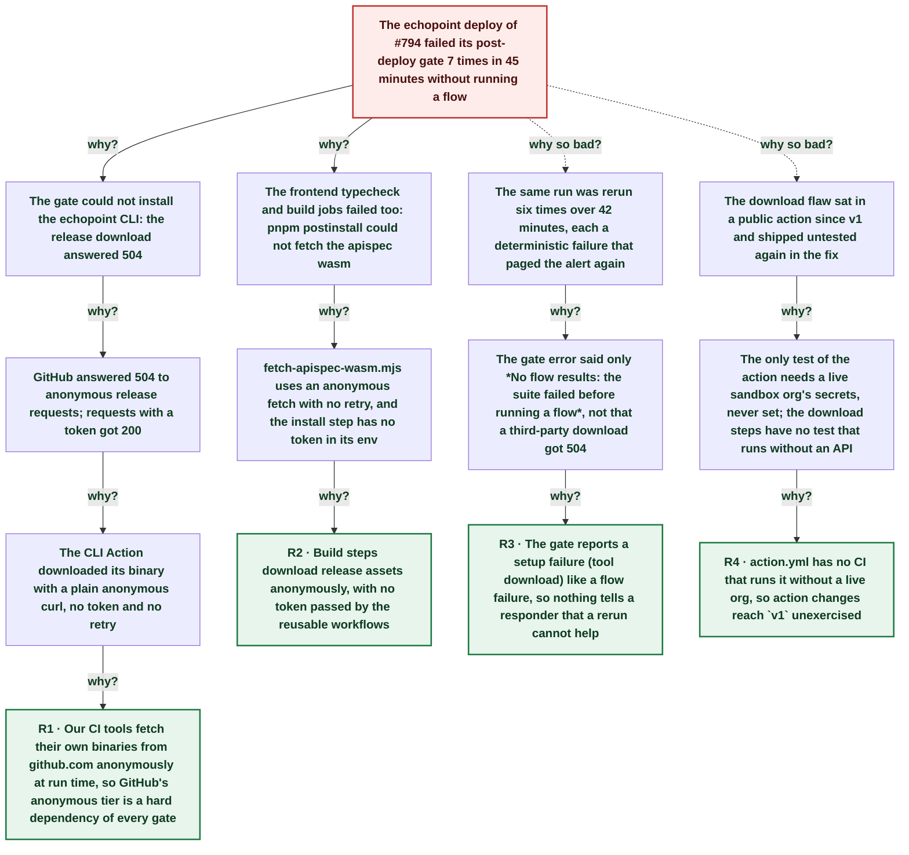

# Echopoint deploy gate failed 7 times: the CLI Action downloaded its binary anonymously during a GitHub anonymous-traffic incident

| | |
|---|---|
| **Date** | 2026-11-09 |
| **Severity** | SEV4 |
| **Status** | In review |
| **Service** | echopoint-cli GitHub Action, infra Deploy Router |
| **Authors** | Nanostack routine (echopoint-investigation) |
| **Duration** | 41m 54s (trigger to resolution) |
| **Time to detect** | 1m 18s |
| **Time to mitigate** | 41m 00s |

> Blameless: this document names systems, processes and missing guards, not people.

## Summary

From 05:16Z on 2026-11-09, GitHub answered **504** to anonymous requests for release assets while authenticated requests still got 200 (GitHub incident *Increased timeouts due to surge in anonymous users*). The echopoint deploy of #794 (Deploy Router run 42566238183) failed all 7 attempts in 45 minutes: the flow gate could not download the echopoint CLI and the frontend jobs could not download the apispec wasm, so no flow ran. Prod was not held: the next deploy (#795, which contains #794) hit a gap in the 504s and promoted to prod at 05:58Z. The echopoint CLI composite Action, which customers also pin as `@v1`, downloaded its own binary with an anonymous `curl` and no retry. echopoint-cli#98 now sends the workflow token, retries, and falls back to an anonymous request; it shipped as v3.14.2 and moved `v1` at 06:29Z.

## Impact

CI and deploy pipeline only. The echopoint deploy of #794 failed 7 times and paged the deploy-failure alert 7 times; the same commit reached prod 43 minutes later through the next deploy. Every caller of `nanostack-dev/echopoint-cli@v1` (the post-deploy gates, and any customer workflow) was exposed to the same failure for the length of the GitHub incident; customer runs are not measurable from here.

- **7** failed attempts of one deploy run
- **45 min** of 504s on anonymous release downloads
- **0** flows run by the failed gate
- **43 min** delay before #794's code reached prod

## Trigger

GitHub throttled anonymous traffic: anonymous `GET github.com/…/releases/download/…` answered 504 in about 70 ms; the same request with a token answered 200.

## Detection

The gate failed at once (`curl: (22) … 504`) and `alert-deploy-failure` fired on every attempt. The error the gate printed, *No flow results: the suite failed before running a flow*, did not say that a third-party download failed, so the run was rerun six times. The routine found the cause at 06:15Z by reading the job logs and githubstatus.

## Resolution

Mitigated when the #795 deploy (05:54Z) downloaded the CLI in a gap of the 504s and promoted c6989ae8 (with #794) to prod at 05:58Z. Fixed by echopoint-cli#98 (authenticated download, retries, anonymous fallback), released as v3.14.2 with `v1` moved at 06:29Z. The frontend `postinstall` download gets the same treatment in a separate fix (A2).

## Timeline (UTC)

| Time | | Event |
|---|---|---|
| 05:14:50 | T−1m 33s | **echopoint#794 merged (tooling only)** ([link](https://github.com/nanostack-dev/echopoint/pull/794)) |
| 05:15:29 | T−54s | **Deploy Router run 42566238183 attempt 1 starts** ([link](https://github.com/nanostack-dev/infra/actions/runs/42566238183)) |
| 05:16:23 | T+0s | **apispec wasm download answers 504** `fetch-apispec-wasm failed: GET …/echopoint-kit/releases/download/v0.4.0/SHA256SUMS answered 504` in the frontend-typecheck job. ([link](https://github.com/nanostack-dev/infra/actions/runs/42566238183/attempts/1)) |
| 05:17:41 | T+1m 18s | **Flow gate fails: CLI download 504, alert fires** `curl: (22) The requested URL returned error: 504` at *Download echopoint CLI*; no flow ran. ([link](https://github.com/nanostack-dev/infra/actions/runs/42566238183/attempts/1)) |
| 05:18:26 | T+2m 03s | **Attempts 2-5 rerun the failed jobs, all 504** 05:18, 05:20, 05:23, 05:31Z, triggered by the shared `devnanostack` identity. |
| 05:42:50 | T+26m 27s | **#793 deploy downloads the CLI in a gap (11 s)** ([link](https://github.com/nanostack-dev/infra/actions/runs/42566809394)) |
| 05:57:23 | T+41m 00s | **#795 deploy gate green (contains #794)** ([link](https://github.com/nanostack-dev/infra/actions/runs/42569930100)) |
| 05:58:17 | T+41m 54s | **c6989ae8 (with #794) live on prod** ([link](https://github.com/nanostack-dev/infra/actions/runs/42569930100)) |
| 05:59:07 | T+42m 44s | **GitHub opens the anonymous-traffic incident** ([link](https://www.githubstatus.com/)) |
| 06:00:03 | T+43m 40s | **Attempt 7 fails on the same 504** |
| ~06:15 | T+58m 37s | **Routine finds the cause; token download returns 200** |
| ~06:28 | T+1h 11m | **echopoint-cli#98 merged** ([link](https://github.com/nanostack-dev/echopoint-cli/pull/98)) |
| ~06:29 | T+1h 13m | **v3.14.2 released, v1 moved to the fix** ([link](https://github.com/nanostack-dev/echopoint-cli/releases/tag/v3.14.2)) |

## Root cause analysis: the five whys

Start at the impact and ask why until the answer is something the team can change. Solid edges ask why it happened; dashed edges ask why the impact was as large as it was.

- **Problem:** The echopoint deploy of #794 failed its post-deploy gate 7 times in 45 minutes without running a flow
  - **Why?** The gate could not install the echopoint CLI: the release download answered 504 _Evidence: Job 128993798293 (and every later attempt): `curl: (22) The requested URL returned error: 504` at *Download echopoint CLI*_
    - **Why?** GitHub answered 504 to anonymous release requests; requests with a token got 200 _Evidence: githubstatus incident *Increased timeouts due to surge in anonymous users* (05:59Z); local probe 06:15Z: anonymous 504 in 0.07 s, `Authorization: Bearer` 200 in 0.4 s on the same URL_
      - **Why?** The CLI Action downloaded its binary with a plain anonymous curl, no token and no retry _Evidence: `echopoint-cli/action.yml` before #98: `curl -fsSL -o … "$url"`; a TODO marked the step as v1 hardening debt_
        - **Why?** Our CI tools fetch their own binaries from github.com anonymously at run time, so GitHub's anonymous tier is a hard dependency of every gate → **Root cause R1** (fixed by A1, A5)
  - **Why?** The frontend typecheck and build jobs failed too: pnpm postinstall could not fetch the apispec wasm _Evidence: Job 128993235600: `fetch-apispec-wasm failed: GET …/SHA256SUMS answered 504`_
    - **Why?** fetch-apispec-wasm.mjs uses an anonymous fetch with no retry, and the install step has no token in its env _Evidence: `apps/frontend/scripts/fetch-apispec-wasm.mjs` `download()`; infra `frontend-typecheck.yml` env holds no GITHUB_TOKEN_
      - **Why?** Build steps download release assets anonymously, with no token passed by the reusable workflows → **Root cause R2** (fixed by A2, A5)
  - **Why so bad?** The same run was rerun six times over 42 minutes, each a deterministic failure that paged the alert again _Evidence: Attempts 2-7 at 05:18, 05:20, 05:23, 05:31, 05:57, 05:59Z, `triggering_actor` devnanostack_
    - **Why?** The gate error said only *No flow results: the suite failed before running a flow*, not that a third-party download got 504 _Evidence: Job 129006275798 lines 312-378_
      - **Why?** The gate reports a setup failure (tool download) like a flow failure, so nothing tells a responder that a rerun cannot help → **Root cause R3** (fixed by A3)
  - **Why so bad?** The download flaw sat in a public action since v1 and shipped untested again in the fix _Evidence: `Action Sandbox Integration` was `skipped` on #98 and on main (no sandbox secrets, `ECHOPOINT_SANDBOX_ENABLED` unset)_
    - **Why?** The only test of the action needs a live sandbox org's secrets, never set; the download steps have no test that runs without an API _Evidence: `.github/workflows/action-sandbox.yml`: gated on `vars.ECHOPOINT_SANDBOX_ENABLED`, skips when `ECHOPOINT_SANDBOX_*` secrets are absent_
      - **Why?** action.yml has no CI that runs it without a live org, so action changes reach `v1` unexercised → **Root cause R4** (fixed by A4)

## Root causes

- **R1** Our CI tools fetch their own binaries from github.com anonymously at run time, so GitHub's anonymous tier is a hard dependency of every gate
- **R2** Build steps download release assets anonymously, with no token passed by the reusable workflows
- **R3** The gate reports a setup failure (tool download) like a flow failure, so nothing tells a responder that a rerun cannot help
- **R4** action.yml has no CI that runs it without a live org, so action changes reach `v1` unexercised

## Contributing factors

- GitHub's 504s were intermittent, so runs that hit a gap passed and hid the pattern.
- A GitHub incident with the same shape (timeouts for unauthenticated users) happened the day before, 10:36-12:32Z, without hitting a gate.

## Lessons learned

### What went well

- The gate failed closed: no deploy promoted without flows running.
- Job logs named the exact URL and status, so the cause was clear once read.

### What went wrong

- Six reruns of a deterministic failure, each paging the alert.
- A known v1 TODO in a public action's download step was never closed.

### Where we got lucky

- The #793 and #795 deploys hit gaps in the 504s and promoted prod, so nothing was held. With continuous 504s every deploy of both products would have stopped at dev.
- No customer report: any customer pinning `@v1` would have seen the same failure during the incident.
- #98 had no CI that runs the action; a local simulation under macOS bash 3.2 was the only test before `v1` moved.

## Action items

| ID | Action | Type | Owner | Due | Status | Ticket | Fixes |
|---|---|---|---|---|---|---|---|
| A1 | CLI Action downloads with the workflow token (`github-token` input), retries, anonymous fallback; release v3.14.2, move v1 | prevent | Nanostack routine (echopoint-investigation) |  | done | [echopoint-cli#98](https://github.com/nanostack-dev/echopoint-cli/pull/98) | R1 |
| A2 | fetch-apispec-wasm sends GITHUB_TOKEN/GH_TOKEN when set and retries 5xx; infra frontend install steps pass GITHUB_TOKEN | prevent | Nanostack routine (echopoint-investigation) | 2026-11-10 | open |  | R2 |
| A3 | Gate names a failed setup step and its HTTP status (e.g. `SETUP-FAILED download-cli 504: rerun after githubstatus is green`) instead of the generic no-results error | detect | ci-workflows maintainers | 2026-11-23 | open |  | R3 |
| A4 | Add a hermetic action job (resolve + download + `echopoint --help` on linux/macos/windows) that runs on every action.yml PR; enable the live sandbox when secrets exist | detect | Nanostack routine (echopoint-investigation) | 2026-11-09 | open | [echopoint-cli action-smoke](https://github.com/nanostack-dev/echopoint-cli/blob/main/.github/workflows/action-smoke.yml) | R4 |
| A5 | Workspace AGENTS.md: CI downloads from github.com send the workflow token and retry | process | Nanostack routine (echopoint-investigation) |  | done |  | R1, R2 |

## Responders

- **Investigation and fix**: Nanostack routine (echopoint-investigation)

## Messaging

### Internal

Echopoint deploy of #794 failed 7 times 05:15-06:00Z: GitHub 504'd anonymous release downloads (CLI Action, frontend wasm). Prod not held (#795 promoted at 05:58Z). Fixed in echopoint-cli#98 (v3.14.2, v1 moved); frontend fix in progress.

### Customers

None sent. If a customer reports `curl: (22) … 504` from the Echopoint GitHub Action on 2026-11-09: GitHub throttled anonymous downloads; `@v1` now downloads with the workflow token.

## Supporting information

- [Atelier postmortem](http://nanostack-dev-1340p:4320/postmortems/01a1bf01-fb85-7911-b3d1-9ea426eea035)
- [Deploy Router run 42566238183](https://github.com/nanostack-dev/infra/actions/runs/42566238183)
- [echopoint-cli#98](https://github.com/nanostack-dev/echopoint-cli/pull/98)
- [GitHub status](https://www.githubstatus.com/)
